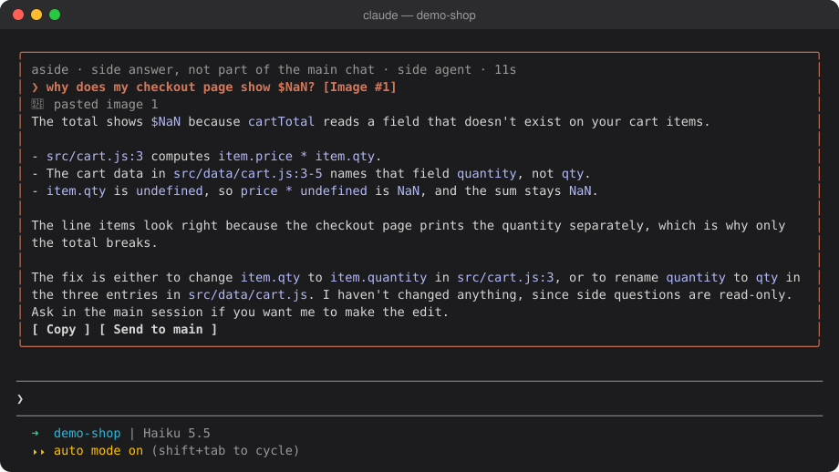
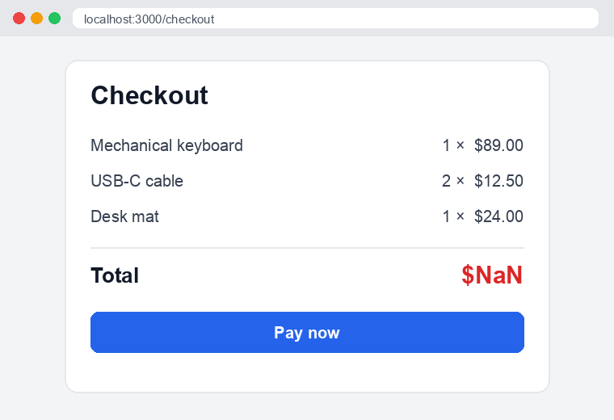
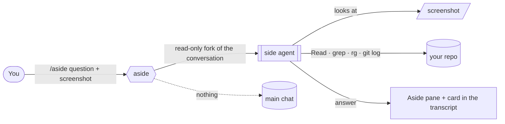

<h1 align="center">/aside</h1>

<p align="center">
  <b>Like <code>/btw</code>, but it can see.</b><br>
  Paste a screenshot, ask anything about your project, and get an answer checked against your actual code.<br>
  Claude keeps working the whole time, and your main chat never hears about it.
</p>

<p align="center">
  
  
  
  
  
</p>

<p align="center">
  
</p>

---

## The problem

Claude is fifteen minutes into a refactor. You look at your app and something is off: the checkout total says **$NaN**.

You have three options, and none of them is good:

1. **Interrupt Claude.** It loses its train of thought on the big task.
2. **Wait.** Your question sits there for twenty minutes.
3. **Use `/btw`.** It can't see your screenshot, and it can't open a single file. It can only guess from what's already in the chat.

## The fix

<table>
<tr>
<td width="50%" align="center"><b>1. You paste this</b><br><br></td>
<td width="50%" align="center"><b>2. You type this</b><br><br><code>/aside why does my checkout page show $NaN? [Image #1]</code><br><br><b>3. About 11 seconds later</b><br><br>it has looked at the screenshot, searched the code, and found that <code>src/cart.js:3</code> reads <code>item.qty</code> while the data in <code>src/data/cart.js</code> calls it <code>quantity</code>.<br><br><i>The main session never noticed.</i></td>
</tr>
</table>

That's a real capture at the top of this page, not a mock-up, and it was answered by Haiku.

## Install

At the prompt of a Claude Code terminal session:

```
/plugin install aside --marketplace anugrah55/claude-aside
```

Answer `y` to add the marketplace, then pick a scope (user scope works everywhere). It's active right away; there's nothing to restart.

From a shell:

```
claude plugin install aside --marketplace anugrah55/claude-aside
```

In the desktop app, where `/plugin` doesn't run: click **+** next to the prompt box, then **Plugins**, **Add marketplace** with `anugrah55/claude-aside`, then **Add plugin**.

> Needs a Claude Code build with plugin mods (function hooks). It was built and tested on Claude Code 2.1.329 on macOS.

## Use it

| You type | You get |
| --- | --- |
| `/aside <question>` | A read-only side agent that sees the conversation, your code and your images |
| `/aside -q <question>` | An instant answer from the conversation alone, the `/btw` way (about a second) |
| `/aside` | The Aside pane: your side-chat thread, with a box for follow-ups |
| `/aside clear` | An empty side chat |
| `/aside help` | The cheat sheet |

There are three ways to add an image:

- **Paste a screenshot** with Ctrl+V. It shows up as `[Image #1]`.
- **Drag in a file** while Claude is idle.
- **Type a path**: `/aside why is this blurry? ~/Desktop/logo.png`

**Point at anything.** In the fullscreen terminal, select some text in the transcript first, then ask *"what does this mean?"*. The selection goes along with your question.

**Act on an answer.** Each answer has three buttons. In the pane, the newest answer also responds to a single key:

| Key | Button | What it does |
| --- | --- | --- |
| `c` | Copy | Copies the answer to your clipboard |
| `m` | Send to main | Quotes the answer into your prompt box. You decide whether to pass it to the main session |
| `d` | Dig deeper | Sends an instant answer on to the full side agent, which can read your code |

## `/aside` vs `/btw`

`/btw` is great. `/aside` does everything it does, then keeps going.

|  | `/btw` | `/aside` |
| --- | :---: | :---: |
| Ask while Claude is mid-task | ✅ | ✅ |
| Knows the whole conversation | ✅ | ✅ |
| Stays out of the main chat's history | ✅ | ✅ (pasted images too) |
| Instant answer from the conversation | ✅ | ✅ `/aside -q` |
| **Sees screenshots and images** | ❌ | ✅ |
| **Opens your code to check its answer** | ❌ no tool access | ✅ read-only |
| **Cites the exact line** | only if the file is already in the chat | ✅ `src/cart.js:3` |
| A thread you can scroll back through | ❌ overlay you dismiss | ✅ side pane + a card in the transcript |
| Follow-up questions | ✅ | ✅ plus a follow-up box |
| **Ask about selected text** | ❌ | ✅ |
| Copy the answer | ✅ `c` | ✅ `c` |
| **Hand the answer to the main session** | copy and paste it yourself | ✅ `m` quotes it into your prompt |
| Escalate a quick answer | ✅ `f` forks a subagent | ✅ `d` Dig deeper |
| **Use it from a script** | — | ✅ `claude -p "/aside …"` |

## Why you'll want it

- 📸 **It sees what you see.** It looks at the screenshot you pasted. No more describing a bug in words.
- 🧠 **It knows the story.** It runs as a fork of your conversation, so it knows what you and Claude have been building and why.
- 🔍 **It checks instead of guessing.** It reads files and searches the repo, then points at `file:line`.
- 🏃 **It never blocks you.** It answers in the background, even while Claude is in the middle of a task.
- 🙈 **It never pollutes the main chat.** The question, the pasted image and the answer all stay out of it. This was tested: after an `/aside` about a screenshot, the main model was asked whether it had seen any image. It said no.
- 🛡️ **It can't break anything.** It's read-only by design, with two independent guards and no web access. Details below.
- 🤖 **It works in scripts.** `claude -p "/aside where is auth handled?"` prints the answer.

## How it works



- **It runs immediately.** `/aside` is registered as an *immediate* command, so it runs at once even while a turn is streaming.
- **Deep questions** start a background fork of the main conversation. It inherits everything said so far and reads it from the prompt cache. If no fork can be made, a fresh read-only helper answers instead, with a digest of the recent conversation.
- **`-q` questions** make one tool-less request over the cached conversation, the same mechanism `/btw` uses.
- **Images** are found in three ways:
  - a path in the question;
  - a paste while Claude is idle: the engine's hidden image row is caught, then scrubbed from the main chat;
  - a paste while Claude is busy: Claude Code drops it, so aside reads the screenshot from your clipboard and labels it that way.
- **Answers** land in the Aside pane and as a display-only card in the transcript. The model never reads that card, and the side agent's report is taken before it reaches the main loop.

## Safety and privacy

- **Read-only, twice over.** A side agent can only call Read, Glob, Grep and Bash. Every shell command must pass two checks:
  - a strict parser that reads quotes and escapes like a shell: only pipelines of reading programs (`grep`, `rg`, `find` without `-exec`, `git log`/`diff`/`show`…), with no redirection except to `/dev/null`, and no chaining or substitution;
  - Claude Code's own read-only verdict.
- **No web access.** A fork holds your whole conversation, and an image could carry text telling it to send that somewhere. So side agents get no fetch or search tools.
- **Your images stay local.** Pasted images are saved to a temp folder for the side agent to read. The clipboard is read only when a paste couldn't be delivered.
- **Nothing reaches the main chat.** The command's text is scrubbed from the transcript the model sees, and so is the pasted image.
- **Cost.** A deep question runs a forked agent on your session's model, reading the conversation from the prompt cache. `-q` is one cached request. Both count toward your usual usage.

## FAQ

<details><summary><b>It says the pasted image didn't reach it.</b></summary>

Claude Code drops images from commands typed while it's busy. aside then reads your clipboard instead, which works for screenshots you copied there. A file dragged in mid-turn can't be recovered that way, so paste it again or type its path.
</details>

<details><summary><b>I don't see the Aside pane.</b></summary>

While a side agent runs, Claude Code's own *Agents* tab can sit on top of it. Click the **Aside** tab. The answer also appears as a card in the transcript, so you won't miss it.
</details>

<details><summary><b>Why was a shell command refused?</b></summary>

Side questions are read-only by construction. Anything that isn't plainly a read gets refused, and the agent uses Read instead. If it needs to change something, it tells you to ask the main session, and **Send to main** hands the answer over.
</details>

<details><summary><b>Does it work on Linux and Windows?</b></summary>

Everything works with paths. The clipboard fallback for mid-turn pastes uses `osascript` on macOS and `wl-paste` or `xclip` on Linux. Windows clipboard isn't supported yet.
</details>

<details><summary><b>Something's off. How do I debug it?</b></summary>

Start Claude Code with `ASIDE_DEBUG_FILE=/tmp/aside.log` and open that file after asking. It traces what the mod saw: the command, image rows, clipboard reads, agent starts.
</details>

## Develop

```
claude plugin validate .
claude plugin test .
claude --plugin-dir .
```

The hooks are in `hooks/register.tsx`, the pure helpers (prompts, image paths, the shell parser) are in `hooks/lib.ts`, and the state contract is in `types/index.d.ts`.

## License

[MIT](LICENSE)
